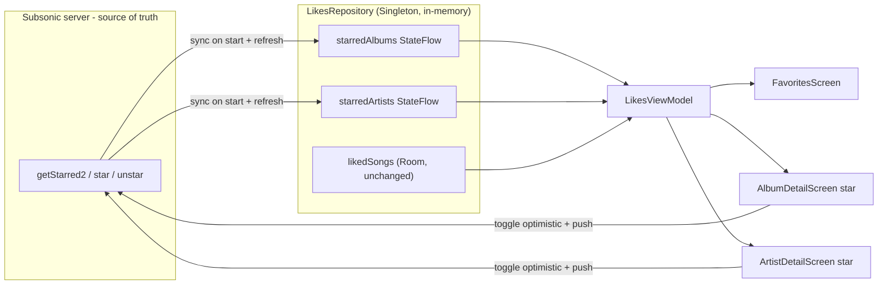

# ✨ Android album & artist favorites + real Favorites screen

## Overview

Bring the Android app to feature parity with iOS by adding **favorited albums and
artists** and rebuilding the song-only "Liked" tab into a three-section
**Favorites** screen (Artists · Albums · Songs). A full iOS↔Android parity audit
(see brainstorm: `docs/brainstorms/2026-10-31-android-ios-parity-brainstorm.md`)
found this is the **only substantive functional gap** between the platforms —
everything else (API surface, playback, downloads, search, browse, playlists,
appearance, song favorites) is already at parity.

Two cosmetic deltas are folded in: rename the tab/screen "Liked" → "Favorites", and
make the Now Playing current-time label follow the thumb while scrubbing.

## Problem Statement / Motivation

- Android stars **songs only**. `LikesRepository` persists liked songs in Room and
  mirrors them to the server, but album/artist favorites don't exist.
- The repository even **discards data it already fetches**:
  `SubsonicRepository.getStarred()` reads only `starred2.song` and drops the
  `album`/`artist` arrays (`SubsonicRepository.kt:79`), and `StarredDto` only
  declares `song` (`SubsonicDtos.kt:137`).
- `SubsonicApi.star/unstar` send only `@Query("id")` (`SubsonicApi.kt:42`), but the
  Subsonic spec (and iOS) star albums via `albumId` and artists via `artistId`.
- The "Liked" tab (`LikedSongsScreen.kt`, tab index 2 in `MainScreen.kt:119`) shows
  songs only, while iOS shows a "Favorites" screen with Artists/Albums/Songs
  sections, an empty state, and pull-to-sync (`SmashSonic/Views/Library/LikedSongsView.swift`).

## Proposed Solution

**Server-backed album/artist favorites, mirroring iOS exactly** (see brainstorm:
decision "Match iOS: server-backed"). Album/artist favorite state is held **in
memory** in the `@Singleton LikesRepository` as `StateFlow`s, synced from the server
via `getStarred2` on app start and on pull-to-refresh. **No new Room tables.** Song
favorites stay in Room, unchanged.

iOS reference mapping:
- `LikesManager` (`SmashSonic/Services/LikesManager.swift`) → `LikesRepository`
  (`starredAlbums/Artists` + `*Ids` sets, `toggleAlbumStar`, `toggleArtistStar`,
  `isAlbumStarred`, `isArtistStarred`, `loadStarredFromServer`).
- `getStarredAlbumsAndArtists()` (`SubsonicClient.swift:235`) →
  `SubsonicRepository.getStarredAlbumsAndArtists()`.
- `star(albumId:)` / `star(artistId:)` (`SubsonicClient.swift:207/215`) → new
  `SubsonicApi`/`SubsonicRepository` overloads using `albumId`/`artistId` params.
- `LikedSongsView` (now "Favorites") → `FavoritesScreen`.

## Technical Approach

### Architecture

Server is the source of truth for album/artist favorites (idempotent
`star`/`unstar`, authoritative `getStarred2`). Since `LikesRepository` is a Hilt
`@Singleton`, its in-memory `StateFlow`s live for the whole process, so every
`LikesViewModel` (one per screen via `hiltViewModel()`) observes the same state —
star toggles on a detail screen are instantly reflected on the Favorites screen and
vice-versa. Toggles are **optimistic** (update the flow immediately, then call the
server; on failure, keep iOS's behavior of logging and leaving optimistic state —
the next sync reconciles).



### Implementation Phases

#### Phase 1: Data layer (DTO, API, repositories)

**`data/remote/dto/SubsonicDtos.kt`** — extend `StarredDto`:
```kotlin
@JsonClass(generateAdapter = true)
data class StarredDto(
    val song: List<SongDto>? = null,
    val album: List<AlbumDto>? = null,   // NEW
    val artist: List<ArtistDto>? = null, // NEW
)
```

**`data/remote/SubsonicApi.kt`** — add nullable album/artist params (Retrofit omits
null `@Query`s, so songs keep working with `id` only):
```kotlin
@GET("rest/star")
suspend fun star(
    @Query("id") id: String? = null,
    @Query("albumId") albumId: String? = null,
    @Query("artistId") artistId: String? = null,
): SubsonicResponseWrapper
// same signature for unstar
```

**`data/repository/SubsonicRepository.kt`** — add album/artist star methods and a
full starred fetch:
```kotlin
suspend fun starAlbum(albumId: String)    { checkError(api.star(albumId = albumId)) }
suspend fun unstarAlbum(albumId: String)  { checkError(api.unstar(albumId = albumId)) }
suspend fun starArtist(artistId: String)  { checkError(api.star(artistId = artistId)) }
suspend fun unstarArtist(artistId: String){ checkError(api.unstar(artistId = artistId)) }

suspend fun getStarredAlbumsAndArtists(): Pair<List<Album>, List<Artist>> {
    val s = api.getStarred2().also { checkError(it) }.subsonicResponse.starred2
    return (s?.album?.map { it.toModel() } ?: emptyList()) to
           (s?.artist?.map { it.toModel() } ?: emptyList())
}
```
(Existing `star(songId)`/`unstar(songId)` call `api.star(id = songId)`.)

**`data/repository/LikesRepository.kt`** — add in-memory album/artist state
(mirrors `LikesManager`):
```kotlin
private val _starredAlbums = MutableStateFlow<List<Album>>(emptyList())
val starredAlbums: StateFlow<List<Album>> = _starredAlbums.asStateFlow()
private val _starredArtists = MutableStateFlow<List<Artist>>(emptyList())
val starredArtists: StateFlow<List<Artist>> = _starredArtists.asStateFlow()
val starredAlbumIds: StateFlow<Set<String>>  // derived / mapped
val starredArtistIds: StateFlow<Set<String>>

fun isAlbumStarred(id: String) = _starredAlbums.value.any { it.id == id }
fun isArtistStarred(id: String) = _starredArtists.value.any { it.id == id }

suspend fun toggleAlbumStar(album: Album)   // optimistic update + starAlbum/unstarAlbum
suspend fun toggleArtistStar(artist: Artist)// optimistic update + starArtist/unstarArtist
```
Extend `syncFromServer()` to also populate `_starredAlbums`/`_starredArtists` from
`getStarredAlbumsAndArtists()` (**replace** the lists — server is authoritative for
albums/artists, unlike songs which are additively merged into Room).

#### Phase 2: ViewModel + startup sync

**`ui/likes/LikesViewModel.kt`** — expose the new flows and toggles:
```kotlin
val starredAlbums = likesRepository.starredAlbums.stateIn(...)
val starredArtists = likesRepository.starredArtists.stateIn(...)
val starredAlbumIds = likesRepository.starredAlbumIds.stateIn(...)
val starredArtistIds = likesRepository.starredArtistIds.stateIn(...)
fun toggleAlbumStar(album: Album)  = viewModelScope.launch { likesRepository.toggleAlbumStar(album) }
fun toggleArtistStar(artist: Artist) = viewModelScope.launch { likesRepository.toggleArtistStar(artist) }
```

**Startup sync:** trigger `syncFromServer()` once on app launch (e.g. in
`SmashSonicApp.kt` / `MainActivity.kt` after a server is configured) so
`isAlbumStarred`/`isArtistStarred` are correct on detail screens **before** the user
opens Favorites. iOS does this in `LikesManager.setModelContext` at startup.

#### Phase 3: Favorites screen + star toggles + tab rename

**Rename `ui/likes/LikedSongsScreen.kt` → `FavoritesScreen.kt`** (composable
`FavoritesScreen`), structured like `LikedSongsView.swift`:
- Empty state when songs + albums + artists are all empty ("No Favorites Yet / …
  Pull down to sync from server.").
- **Artists** section: horizontal row of chips (cover art + name), tap →
  `Route.ArtistDetail`. New `FavoriteArtistChip` composable (reuse `CoverArtImage`).
- **Albums** section: cards (cover art + title/artist), tap → `Route.AlbumDetail`.
- **Songs** section: existing `SongRow` list (unchanged behavior).
- Pull-to-refresh calls `likesViewModel.syncFromServer()`.

**`ui/navigation/Route.kt`** — rename `LikedSongs → Favorites` (route `"favorites"`),
update references in `SmashSonicNavHost.kt` / `MainScreen.kt`.

**`ui/home/MainScreen.kt:119`** — tab label `"Liked"` → `"Favorites"` (keep
`pixel_heart` icon).

**Star toggles on detail screens:**
- `ui/browse/AlbumDetailScreen.kt` — already injects `likesViewModel`; add a star
  `IconButton` (filled/outline heart) in the `TopAppBar` actions, bound to
  `likesViewModel.toggleAlbumStar(album)` and `starredAlbumIds`.
- `ui/browse/ArtistDetailScreen.kt` — **add** `likesViewModel: LikesViewModel =
  hiltViewModel()` param, then the same star action in its `TopAppBar`.

#### Phase 4: Scrubber polish

**`ui/player/NowPlayingScreen.kt`** — when `isSeeking`, show the scrubbed time in the
current-time label instead of the live `currentTimeFormatted`:
```kotlin
val leftLabel = if (isSeeking) formatTime((seekPosition * duration).toLong())
                else currentTimeFormatted
```
(`duration` is already collected in the composable; reuse the VM's `formatTime` or a
local helper.)

## Flow & Edge Case Analysis

- **Server without album/artist starring / empty results** → `starred2.album` /
  `.artist` null → empty lists, empty-state shows. No crash.
- **Toggle while offline / server error** → optimistic flow update stays; error is
  caught & logged (matches iOS `print`). Next `syncFromServer()` reconciles from the
  authoritative server list. Documented divergence from song favorites (which
  persist locally in Room).
- **Pull-to-refresh semantics asymmetry** → songs are *merged additively* into Room
  (never removed on refresh — existing behavior, unchanged); albums/artists are
  *replaced* from the server (authoritative). Intentional; note in code comment.
- **State consistency across screens** → guaranteed by `@Singleton` repository +
  shared `StateFlow`s; no duplicate sources of truth.
- **Idempotency** → Subsonic `star`/`unstar` are idempotent; double-tap is safe.
- **Cover art missing** on a chip/card → `CoverArtImage` placeholder fallback
  (already handles this).
- **Song favorites untouched** → Room path, `LikedSongDao`, and existing sync are
  not modified beyond adding the album/artist fetch to `syncFromServer()`.

## System-Wide Impact

- **Interaction graph:** `FavoritesScreen`/detail star tap → `LikesViewModel` →
  `LikesRepository` (optimistic `StateFlow` emit) → `SubsonicRepository` →
  `SubsonicApi` → server. Startup → `syncFromServer()` → repo flows → all observers.
- **Error propagation:** network errors caught in repository toggle/sync (try/catch,
  as today); UI never throws. `checkError` surfaces Subsonic API errors for the
  new repo methods identically to existing ones.
- **State lifecycle risks:** album/artist state is in-memory only — lost on process
  death and rebuilt on next startup sync (acceptable, matches iOS). No orphaned rows
  (no new persistence).
- **API surface parity:** `star`/`unstar` signature change is backward-compatible
  (all params nullable); existing `star(songId)` callers unaffected.

## Acceptance Criteria

### Functional
- [ ] Tapping the star on an **Album detail** screen stars/unstars the album on the
      server and updates the icon immediately.
- [ ] Tapping the star on an **Artist detail** screen stars/unstars the artist on the
      server and updates the icon immediately.
- [ ] The **Favorites** screen shows three sections — Artists (chips), Albums
      (cards), Songs (rows) — each hidden when empty.
- [ ] Tapping an artist chip navigates to Artist detail; tapping an album card
      navigates to Album detail.
- [ ] An **empty state** appears when there are no favorites of any kind.
- [ ] **Pull-to-refresh** re-syncs starred songs, albums, and artists from the server.
- [ ] Album/artist starred state is correct on detail screens **after app restart**
      (startup sync), without first opening Favorites.
- [ ] The bottom tab reads **"Favorites"** (heart icon retained).
- [ ] While dragging the Now Playing scrubber, the current-time label **follows the
      thumb**.

### Non-Functional / Quality
- [x] No new Room tables or DB migration (schema `1.json` unchanged).
- [x] Existing **song** favorite behavior (Room persistence + server mirror) is
      unchanged.
- [x] `star`/`unstar` param change is backward-compatible (song path untouched —
      `api.star(id = songId)`).
- [x] `assembleDebug` succeeds — **BUILD SUCCESSFUL** (see Environment note below).

> **Implementation status (2026-10-31):** all code written and compiling; the
> functional criteria above are implemented and compile-verified but **not yet
> run on a device/emulator** in this session.
>
> **Environment note:** the committed `gradle.properties`
> `org.gradle.java.home=/usr/lib/jvm/java-21-openjdk` resolves to a **JRE-only**
> package here (no `javac`). A full JDK 21 (21.0.6) lives at
> `/home/amadsen/.sdkman/candidates/java/21.0.6-tem`. The build also needed `sudo`
> because the pre-existing `.gradle/` and `app/build/` are root-owned from earlier
> builds. Working command:
> `sudo env ANDROID_HOME=/root/AndroidSDK ANDROID_SDK_ROOT=/root/AndroidSDK ./gradlew assembleDebug -Dorg.gradle.java.home=/home/amadsen/.sdkman/candidates/java/21.0.6-tem`

## Success Metrics

- Feature-parity audit shows **zero substantive gaps** between iOS and Android for
  favorites and the Now Playing scrubber.
- Starring an album/artist on Android is visible on iOS (and vice-versa) after a
  sync, since both use the same server-side starred state.

## Dependencies & Risks

- **Risk:** some Subsonic servers ignore `albumId`/`artistId` and only honor `id`.
  *Mitigation:* iOS already uses `albumId`/`artistId` against the same servers
  (Navidrome) successfully; if a target server misbehaves, fall back to `id`.
  Low risk.
- **Risk:** build toolchain (JDK 21 + Android SDK at `/root/AndroidSDK`) must be
  available in this environment — unverified this session. *Mitigation:* confirm a
  clean `assembleDebug` early in implementation.
- **Dependency:** none beyond the already-present Retrofit/Moshi/Hilt/Compose stack.

## Files Touched (summary)

| File | Change |
|---|---|
| `data/remote/dto/SubsonicDtos.kt` | `StarredDto` + `album`/`artist` lists |
| `data/remote/SubsonicApi.kt` | `star`/`unstar` nullable `albumId`/`artistId` params |
| `data/repository/SubsonicRepository.kt` | `starAlbum/unstarAlbum/starArtist/unstarArtist`, `getStarredAlbumsAndArtists()` |
| `data/repository/LikesRepository.kt` | in-memory starred album/artist flows + toggles; extend `syncFromServer()` |
| `ui/likes/LikesViewModel.kt` | expose starred album/artist flows + toggles |
| `ui/likes/LikedSongsScreen.kt` → `FavoritesScreen.kt` | three-section Favorites screen + empty state + `FavoriteArtistChip` |
| `ui/navigation/Route.kt`, `SmashSonicNavHost.kt` | rename `LikedSongs` → `Favorites` |
| `ui/home/MainScreen.kt` | tab label "Liked" → "Favorites" |
| `ui/browse/AlbumDetailScreen.kt` | album star action in TopAppBar |
| `ui/browse/ArtistDetailScreen.kt` | inject `LikesViewModel`; artist star action |
| `SmashSonicApp.kt` / `MainActivity.kt` | trigger startup `syncFromServer()` |
| `ui/player/NowPlayingScreen.kt` | scrub-time label follows thumb |

## Sources & References

### Origin
- **Brainstorm:** `docs/brainstorms/2026-10-31-android-ios-parity-brainstorm.md` —
  carried-forward decisions: (1) favorited albums/artists + 3-section Favorites
  screen is the only substantive parity gap; (2) server-backed data model, no new
  Room tables; (3) rename "Liked" → "Favorites"; (4) include scrub-label polish.

### Internal references
- iOS spec: `SmashSonic/Services/LikesManager.swift`,
  `SmashSonic/ViewModels/LikesViewModel.swift`,
  `SmashSonic/Views/Library/LikedSongsView.swift`,
  `SmashSonic/Services/SubsonicClient.swift:199-248`.
- Android current: `SubsonicRepository.kt:69-82`, `SubsonicApi.kt:42-49`,
  `SubsonicDtos.kt:137`, `LikesRepository.kt`, `LikesViewModel.kt`,
  `MainScreen.kt:119`, `AlbumDetailScreen.kt`, `ArtistDetailScreen.kt`,
  `NowPlayingScreen.kt:144-160`.

### Conventions (CLAUDE.md)
- JDK 21 + `source /etc/profile.d/AndroidSDK`; build with `./gradlew assembleDebug`.
- Coil 3 quirks (SubcomposeAsyncImage for composable error fallbacks) relevant to
  `FavoriteArtistChip`.
